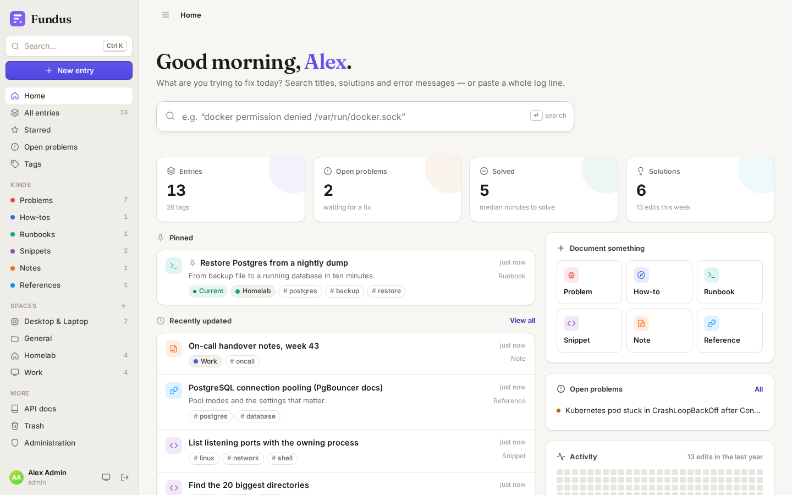
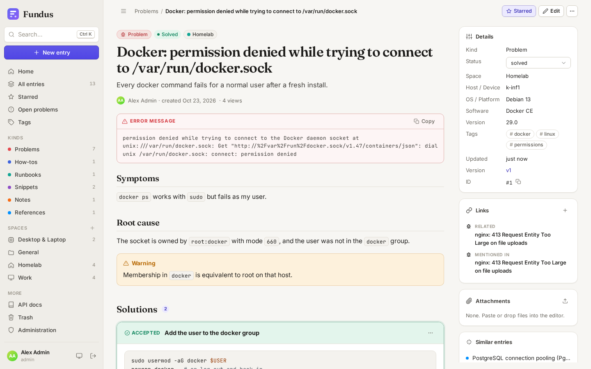
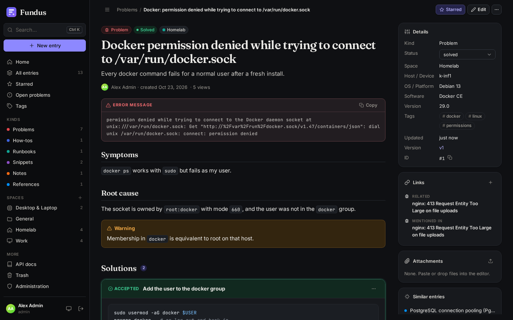

# Fundus

A self-hosted, general-purpose knowledge base, built first of all for **IT problems and their solutions**. Write down what broke and how you fixed it, then find it again in seconds, even by pasting the raw error message.



| Entry with solutions | Dark mode |
| --- | --- |
|  |  |

## Features

**Knowledge**
- **Entry kinds** with their own icon, colour, statuses, suggested fields and Markdown template. The defaults are *Problem*, *How-to*, *Runbook*, *Snippet*, *Note* and *Reference*. Admins can add more, e.g. *Incident* or *Recipe*.
- **Problems collect solutions.** Others can vote "worked for me", and one solution can be accepted. Accepting a solution marks an open problem *solved*.
- **Verbatim error text** sits next to the description. It is searched with trigram similarity, so a pasted log line finds the matching entry.
- **Spaces** (Homelab, Work, Customer X …), **tags** with autocomplete and rename/merge, and free **key/value fields** (OS, software, version, host …).
- **Links between entries** (*related*, *duplicate of*, *caused by*, *depends on*, *supersedes*), plus `[[42]]` wiki references with automatic backlinks.
- **Markdown** with syntax highlighting, task lists, tables, footnotes and GitHub-style callouts (`> [!WARNING]`). Paste or drop images straight into the editor.
- **Full revision history** with line and word diffs. Any version can be restored. Optimistic locking stops two people from silently overwriting each other.
- **Duplicate detection** while you type a title or error message.
- Pin, star, trash and restore, view counts, Markdown export of single entries, and a JSON export/import of everything.
- Read-only **share links** with optional expiry for people without an account.

**Finding things**
- PostgreSQL full-text search (English stemming plus exact tokens) with prefix matching, `"phrases"`, `-exclusions` and `or`. It is combined with trigram similarity on titles and error messages and comes with facets for kind, status, space and tags.
- A command palette (<kbd>Ctrl</kbd>/<kbd>⌘</kbd>+<kbd>K</kbd>) and keyboard shortcuts throughout (<kbd>?</kbd> lists them).
- A dashboard with stats, an activity heatmap, pinned entries and open problems.

**Sign-in & security**
- **Passkeys** (WebAuthn, discoverable, so they work with Bitwarden, iCloud Keychain, Windows Hello and security keys).
- **SSO via OpenID Connect**, tuned for **Zitadel**: PKCE, userinfo merge, organisation restriction, project-role mapping. See [docs/zitadel.md](docs/zitadel.md).
- Username + password (bcrypt), which can be turned off. Login is rate-limited and failed logins are recorded in the audit log.
- Roles *admin*, *editor* and *viewer*. API tokens carry scopes (*read*, *write*, *admin*), and sessions can be revoked.
- CSRF protection, a strict CSP, sanitised Markdown, and uploads served sandboxed.

**Integration**
- A **REST API** for everything the UI does, documented as OpenAPI 3.1 (`/api/openapi.yaml`). There is also an interactive reference in the app under *API docs*.
- An **MCP endpoint** (`/mcp`), so AI assistants such as Claude can search the knowledge base and document solutions.
- **Webhooks** for entry and solution events, signed with HMAC-SHA256.
- An audit log, a health endpoint and a backup script.

## Quick start (Docker Compose)

```sh
git clone <this repo> fundus && cd fundus
cp .env.example .env            # set POSTGRES_PASSWORD; FUNDUS_UID/GID = `id -u` / `id -g`
mkdir -p data pgdata backups
docker compose up -d --build
docker compose logs fundus      # shows the one-time setup token
```

Open http://127.0.0.1:8080, enter the setup token and create the first admin. To create the admin without the setup step, set `FUNDUS_ADMIN_USER` and `FUNDUS_ADMIN_PASSWORD` in `.env` instead.

The stack uses **no Docker volumes**. All state is in bind-mounted directories next to `docker-compose.yml`:

| Directory | Contents |
| --- | --- |
| `./pgdata` | PostgreSQL 18 data |
| `./data` | uploaded attachments |
| `./backups` | dumps written by `deploy/backup.sh` |

### Behind Traefik

`deploy/compose.traefik.yml` adds the labels for an existing Traefik with an external `proxy` network, the `websecure` entrypoint and the `le` certificate resolver:

```sh
# .env: FUNDUS_HOST=kb.example.com
docker compose -f docker-compose.yml -f deploy/compose.traefik.yml up -d --build
```

Fundus honours `X-Forwarded-Proto` and `X-Forwarded-Host`. In production, set `FUNDUS_RP_ID=kb.example.com` and `FUNDUS_RP_ORIGIN=https://kb.example.com` so passkeys stay bound to that domain.

### Backups

```sh
./deploy/backup.sh                     # pg_dump → ./backups/fundus-<date>.dump, keeps 14 days
```

Back up `./data` as well. *Admin → Import & export* produces a portable JSON export, which can be imported into another instance.

## Configuration

Everything is set through environment variables. `.env.example` documents each one.

| Variable | Default | |
| --- | --- | --- |
| `DATABASE_URL` | — | PostgreSQL URL (compose builds it) |
| `FUNDUS_BASE_URL` | derived | public URL, used for links and the OIDC redirect |
| `FUNDUS_SITE_NAME` | `Fundus` | name shown in the UI |
| `FUNDUS_ADMIN_USER` / `_PASSWORD` | — | bootstrap admin on first start |
| `FUNDUS_PASSWORD_LOGIN` | `true` | allow username/password login |
| `FUNDUS_SESSION_DAYS` | `30` | sliding session lifetime |
| `FUNDUS_MAX_UPLOAD_MB` | `50` | attachment size limit |
| `FUNDUS_RP_ID` / `FUNDUS_RP_ORIGIN` | derived | WebAuthn relying party |
| `FUNDUS_OIDC_*` | — | SSO, see [docs/zitadel.md](docs/zitadel.md) |

## API

All endpoints live under `/api/v1`. Create a token under *Settings → API tokens* and send it as `Authorization: Bearer fdk_…`. For example, to document a problem together with its fix in one call:

```sh
curl -X POST https://kb.example.com/api/v1/entries \
  -H "Authorization: Bearer $FUNDUS_TOKEN" -H "Content-Type: application/json" \
  -d '{"kind":"problem","title":"nginx: 413 Request Entity Too Large",
       "error_text":"413 Request Entity Too Large","tags":["nginx"],
       "solutions":[{"body":"client_max_body_size 100m;","accepted":true}]}'

curl -G https://kb.example.com/api/v1/search -H "Authorization: Bearer $FUNDUS_TOKEN" \
  --data-urlencode 'q=entity too large'
```

The full reference is the OpenAPI document at `/api/openapi.yaml` (or `.json`), rendered in the app under **API docs** with curl examples and a "try it" button. `tools/seed-demo.py` is a small example client that fills an instance with demo content.

### MCP (AI assistants)

```sh
claude mcp add --transport http fundus https://kb.example.com/mcp \
  --header "Authorization: Bearer fdk_…"
```

Tools: `search_knowledge`, `get_entry`, `find_similar`, `list_taxonomy`. Tokens with the *write* scope also get `create_entry`, `update_entry` and `add_solution`.

## Development

Requirements: Go 1.27 and PostgreSQL ≥ 15 (with the `pg_trgm` extension, part of contrib).

```sh
export DATABASE_URL=postgres://localhost/fundus?sslmode=disable
export FUNDUS_ADMIN_USER=admin FUNDUS_ADMIN_PASSWORD=admin-password-1
go run ./cmd/fundus                       # http://localhost:8080

# integration tests: each run creates and drops its own database
FUNDUS_TEST_DATABASE_URL=postgres://postgres@localhost/postgres?sslmode=disable go test ./...
```

Layout:

```
cmd/fundus           entry point (also: -version, -healthcheck)
internal/config      environment
internal/db          pool + embedded SQL migrations
internal/store       all SQL: entries, search, users, sessions, …
internal/markdown    goldmark + chroma + bluemonday
internal/server      HTTP API, auth (sessions, passkeys, OIDC), MCP, webhooks, share pages
web/                 embedded UI (vanilla JS modules, no build step), OpenAPI document, share template
tools/               chroma CSS generator, demo seed script
deploy/              Traefik overlay, backup script
```

The UI has no build step: the files in `web/static` are embedded into the binary as they are. After changing the syntax-highlighting theme, run `go run ./tools/chromacss > web/static/chroma.css`.

Fonts: Inter, JetBrains Mono and Fraunces (SIL Open Font License) are bundled, so nothing is loaded from third-party CDNs.
